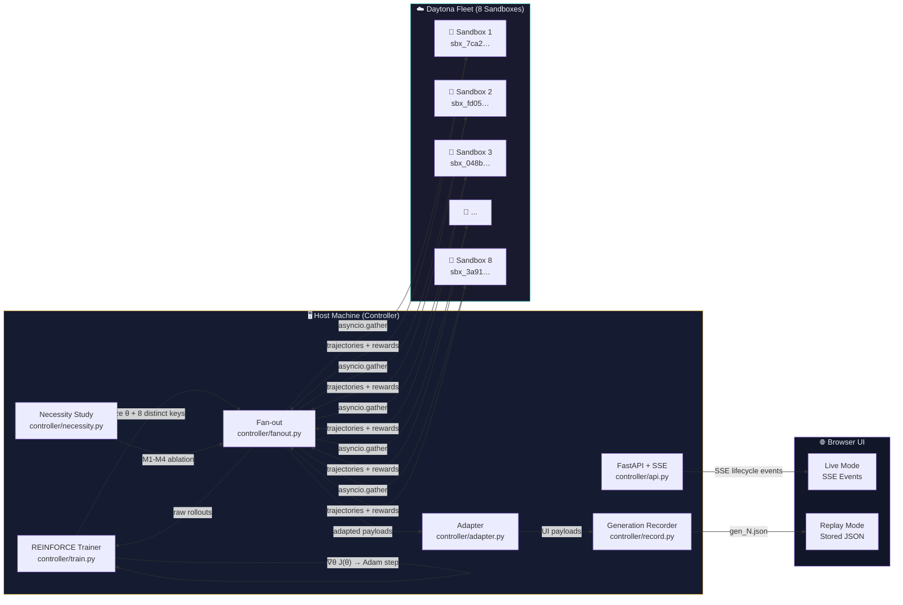
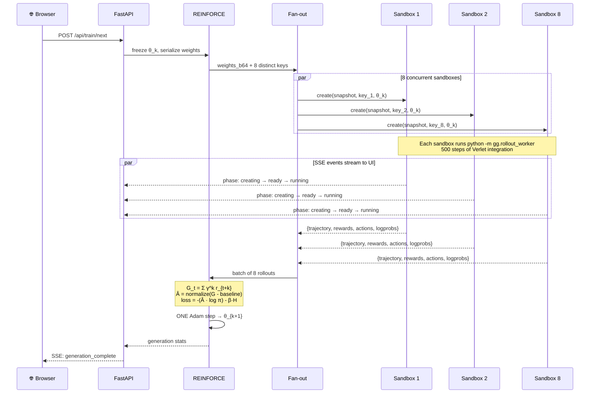
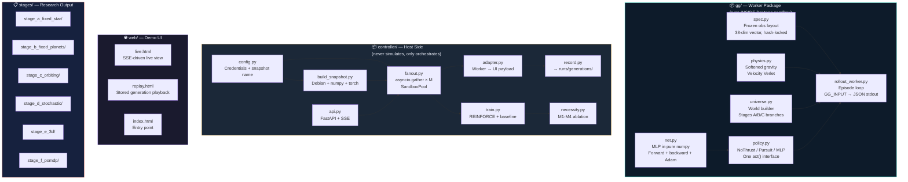
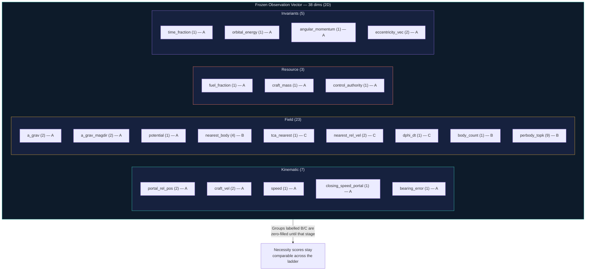
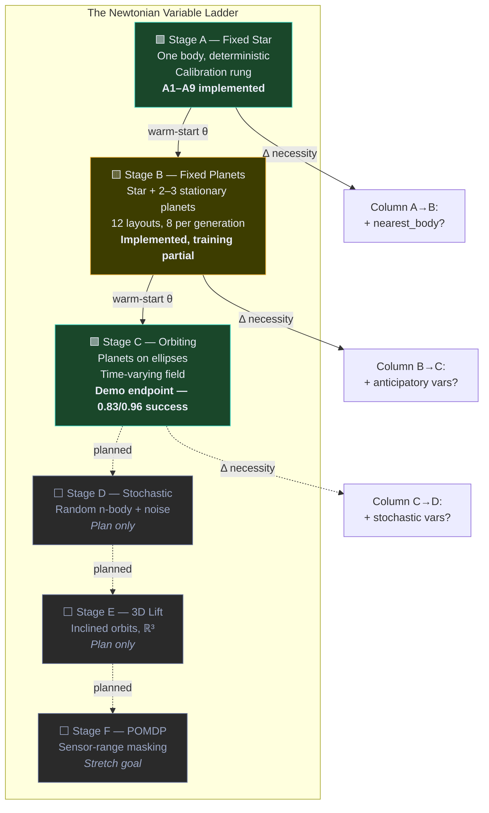
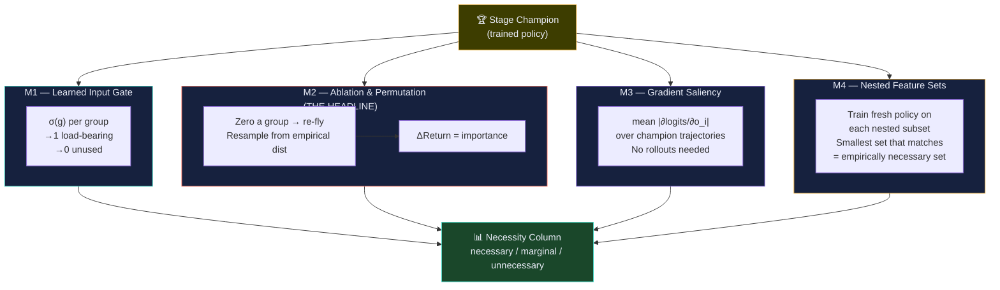
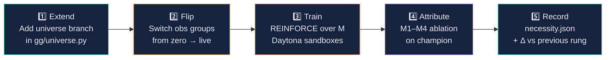
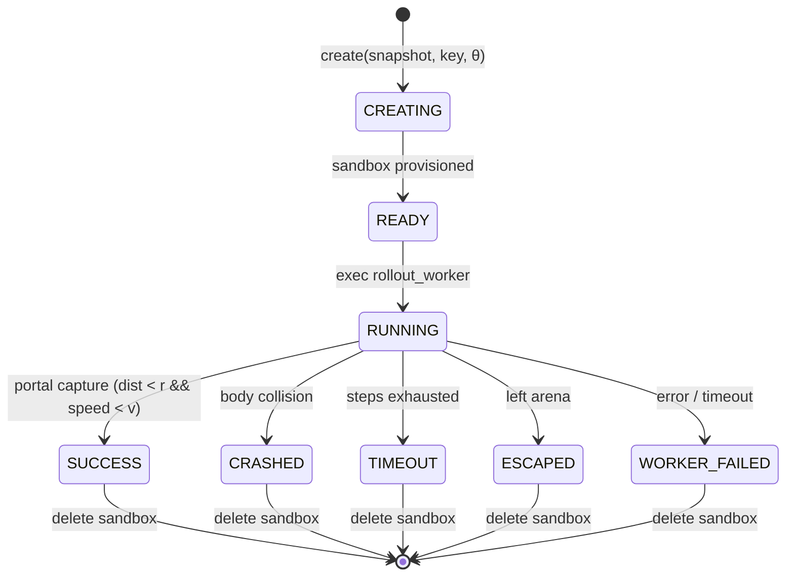
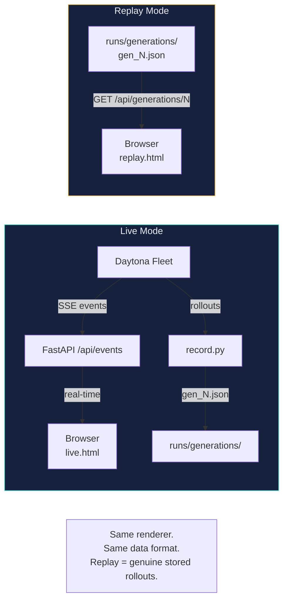

# Gravity Gauntlet — Architecture

> **One universe gives an agent one experience. Daytona gives it many universes at once.**

## System Overview

Gravity Gauntlet is a reinforcement-learning research platform where a spacecraft policy learns to navigate gravitational fields by training across **parallel Daytona sandboxes**. Each rollout runs inside a real, isolated sandbox — not a simulation, not a mock.

---

## Training Loop — One Generation

Each press of **TRAIN NEXT GENERATION** executes the full RL loop end-to-end against real Daytona infrastructure:

---

## Repository Structure

---

## Worker I/O Contract

The worker and controller share exactly one interface — `spec.py`. The worker rejects a mismatched `obs_spec_hash`, so the two can never silently drift.

```mermaid
flowchart LR
    subgraph INPUT["📥 GG_INPUT (env var)"]
        direction TB
        I1["stage: A|B|C"]
        I2["layout_id + orbital_phase"]
        I3["policy_weights_b64"]
        I4["obs_spec_hash: 16a7d04e"]
        I5["max_steps: 500, gamma: 0.99"]
    end

    subgraph WORKER["⚙️ rollout_worker.py"]
        direction TB
        W1["1. Verify obs_spec_hash"]
        W2["2. build_universe(stage, key)"]
        W3["3. Nondimensionalise (L₀, g₀, T₀)"]
        W4["4. 500 Verlet steps"]
        W5["5. Observe → Act → Step → Reward"]
    end

    subgraph OUTPUT["📤 stdout (one JSON line)"]
        direction TB
        O1["sandbox_id, reward, success"]
        O2["termination: portal|collision|timeout|escape"]
        O3["observations[500×38]"]
        O4["actions[500], logprobs[500]"]
        O5["trajectory[500×6], bodies_trajectory"]
    end

    INPUT --> WORKER --> OUTPUT

    style INPUT fill:#1a1a2e,stroke:#3FD6C4,color:#E9ECF7
    style WORKER fill:#151C31,stroke:#F2B33D,color:#E9ECF7
    style OUTPUT fill:#111728,stroke:#8C6BE0,color:#E9ECF7
```

---

## The Observation Superset (38 dimensions, frozen from Stage A)

---

## Stage Ladder — Curriculum Design

Each rung adds **one physical complication** and asks: which Newtonian variables did that complication force into the observation?

---

## Necessity Study — Four Probes (M1–M4)

The ablation study is the research output. It determines which variables the policy **must** observe to fly.

---

## The Five-Beat Loop (per stage)

---

## Sandbox Lifecycle

---

## Data Pipeline — Live vs Replay

