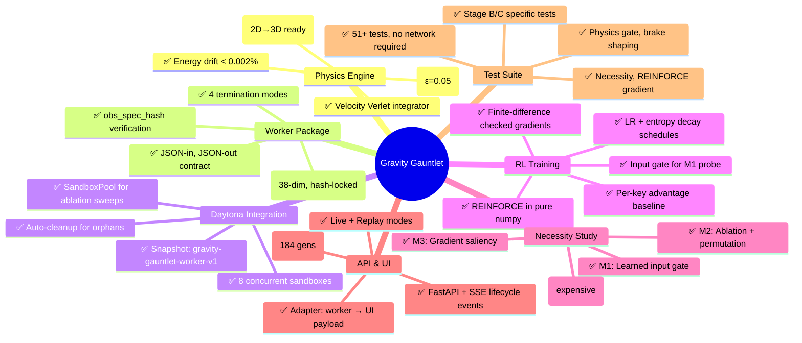

# Gravity Gauntlet — Project Status

> Last updated: 2026-08-31

## TL;DR

The full RL-over-Daytona pipeline is **operational end-to-end**: physics, worker, snapshot, fan-out, adapter, recording, SSE API, REINFORCE trainer, and M1–M4 necessity study — all running against real Daytona sandboxes. **184 generations** have been recorded. Stages A–C are implemented with honest partial results; Stages D–F exist as documented plans.

---

## Stage Progress Overview

```mermaid
gantt
    title Stage Implementation Progress
    dateFormat X
    axisFormat %s

    section Stage A — Fixed Star
    Physics (A1–A2)            :done, a1, 0, 2
    Worker & Spec (A3–A4)      :done, a3, 2, 4
    Snapshot & Rollout (A5–A6) :done, a5, 4, 6
    Fan-out & SSE (A7)         :done, a7, 6, 7
    REINFORCE Training (A8)    :active, a8, 7, 9
    Necessity Study (A9)       :active, a9, 9, 10

    section Stage B — Fixed Planets
    Universe Branch            :done, b1, 4, 5
    Fan-out (8 worlds)         :done, b2, 6, 7
    Training                   :crit, b3, 7, 9
    Necessity                  :crit, b4, 9, 10

    section Stage C — Orbiting
    Universe Branch            :done, c1, 5, 6
    Braking Fix                :done, c2, 7, 8
    Training                   :done, c3, 8, 9
    Necessity                  :active, c4, 9, 10

    section Stage D–F
    Planned                    :d1, 10, 12
```

---

## Detailed Status per Stage

### 🟩 Stage A — One Fixed Star (Calibration)

| Step | Description | Status |
|------|-------------|--------|
| A1 | Observation builder — 38-dim frozen superset | ✅ PASS |
| A2 | Episode loop — Verlet integration, nondimensionalisation | ✅ PASS |
| A3 | Worker entrypoint — `obs_spec_hash` verification | ✅ PASS |
| A4 | Physics gate — energy drift 1.4e-05 (budget: 1%) | ✅ PASS |
| A5 | Snapshot — `gravity-gauntlet-worker-v1` active | ✅ PASS |
| A6 | One real rollout — portal in 183 steps | ✅ PASS |
| A7 | Fan-out ×8 — 8 concurrent, 8 distinct IDs | ✅ PASS |
| A8 | REINFORCE — 0.77 held-out success (gate: 0.80) | 🟨 NEAR MISS |
| A9 | Necessity — 3 necessary, 2 overturns, Spearman 0.596 | 🟨 GATE RED |

**Key finding from A9:** `a_grav` was predicted *necessary* and measured **exactly 0.00** — in a single Kepler well, the field is a fixed function of position, so the policy doesn't need it. `closing_speed_portal`, predicted *unnecessary*, came back clearly *necessary* — because A7 gates capture on speed.

### 🟨 Stage B — Star + Fixed Planets

| Step | Description | Status |
|------|-------------|--------|
| Universe branch | 12 layouts, 8 distinct per generation | ✅ |
| Fan-out gate | 8 concurrent sandboxes, 8 different worlds | ✅ PASS |
| Training | 150 gens, champion 0.38 held-out (did not rise) | ❌ GATE RED |
| Necessity | Not run (champion too weak for meaningful ablation) | ⬜ BLOCKED |

**Key learning:** Batch-wide advantage baseline across mixed layouts encoded *which layout you drew*, not action quality. Per-key centring recovered from 0.03 → 0.40 success.

### 🟩 Stage C — Orbiting Planets (Demo Endpoint)

| Step | Description | Status |
|------|-------------|--------|
| Universe branch | Circular orbits, `orbital_phase` per rollout | ✅ |
| Braking fix | `k_brake = 100`, potential-based speed shaping | ✅ |
| Fan-out gate | 8 distinct `(layout, phase)` pairs | ✅ PASS |
| Training | 150 gens, champion 0.83 phases / 0.96 layouts | ✅ PASS |
| Necessity (M1–M3) | Predicted anticipatory variable NOT found | 🟨 INFORMATIVE |
| Necessity (M4) | Nested feature sets | ⬜ NOT RUN |

**Key finding:** The champion learned a fixed trajectory, not a control law — zeroing `portal_rel_pos` costs nothing because the portal position is fixed across layouts. This was independently confirmed by Stage D rotation tests (0.62 → 0.06).

### ⬜ Stages D–F — Planned

| Stage | Description | Status |
|-------|-------------|--------|
| D — Stochastic | Randomised n-body + noise | Plan only |
| E — 3D Lift | Inclined orbits, ℝ³ | Plan only |
| F — POMDP | Sensor-range masking | Stretch goal |

---

## Infrastructure Status

---

## Recorded Generations

**184 generations** recorded in `runs/generations/`, spanning all three active stages. Each is a genuine rollout from real Daytona sandboxes — no fabricated data.

| Generation Range | Stage | Notes |
|---|---|---|
| gen_1 | A | First fan-out, 8 sandboxes |
| gen_2 | B | First multi-world generation |
| gen_3 | C | First orbiting-body generation |
| gen_10 – gen_60 | A/B/C | Training runs |
| gen_70 – gen_160 | A/B/C | Extended training + necessity sweeps |
| gen_161 – gen_184 | C | Latest training with brake shaping |

---

## What's Working

- ✅ **Full end-to-end pipeline**: policy → 8 Daytona sandboxes → trajectories → gradient step → improved policy
- ✅ **Physics integrity**: energy drift 700× inside budget, all 4 terminations verified, checksums match local ↔ sandbox
- ✅ **Real parallelism**: 8 concurrent sandboxes, 8 distinct IDs, staggered completion
- ✅ **Honesty rules**: no fabricated data, failures shown as failures, replay uses genuine stored rollouts
- ✅ **Stage C champion**: 83% on unseen phases, 96% on unseen layouts — up from 0%
- ✅ **Necessity overturns**: `a_grav` predicted necessary, measured unnecessary. Real finding.

## What's In Progress

- 🟨 **Stage A gate**: 0.77 vs 0.80 bar — needs more generations at lower entropy
- 🟨 **Stage B training**: per-key baseline helps but champion still weak — more fleet time needed
- 🟨 **Necessity gate stability**: Spearman fails on full rank; verdict-class stability passes on top-3
- 🟨 **M4 nested feature sets**: not run yet (trains 5 policies, expensive)

## What's Open

- ⬜ **Portal-relative observation frame**: the fix that makes the policy learn a control law, not a fixed trajectory
- ⬜ **Stages D–F**: planned, blocked on the observation frame fix
- ⬜ **`k_proximity` tuning**: brake term raises collisions at Stage B; the obvious fix is unrun
- ⬜ **PPO upgrade**: clipped ratio for multi-step reuse of expensive sandbox batches

---

## Key Metrics

| Metric | Value |
|--------|-------|
| Observation dimensions | 38 (2D, frozen from Stage A) |
| Network parameters | ~6–10k (2×64 tanh MLP) |
| Actions | 9 (coast + 8-compass thrust) |
| Sandboxes per generation | 8 |
| Sandbox boot time | ~1–3 s |
| Episode steps | 500 max |
| Total generations recorded | 184 |
| Total tests | 51+ (no network required) |
| Energy drift | 1.4e-05 (budget: 0.01) |
| Stage C held-out success | 0.833 (phases) / 0.958 (layouts) |
